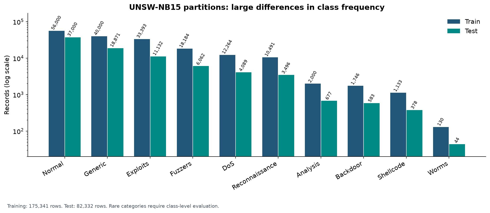
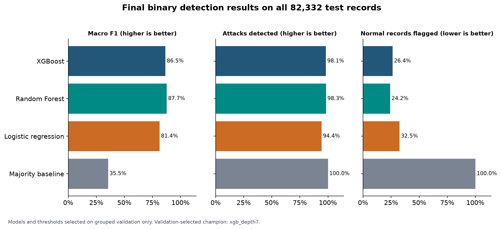
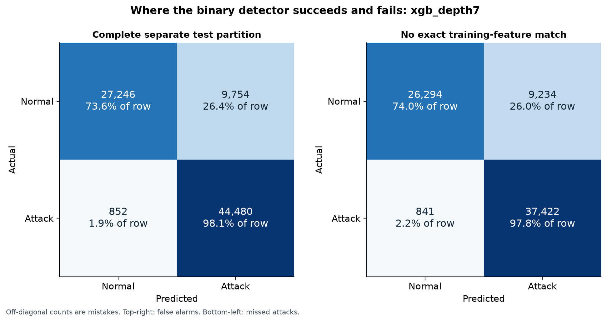
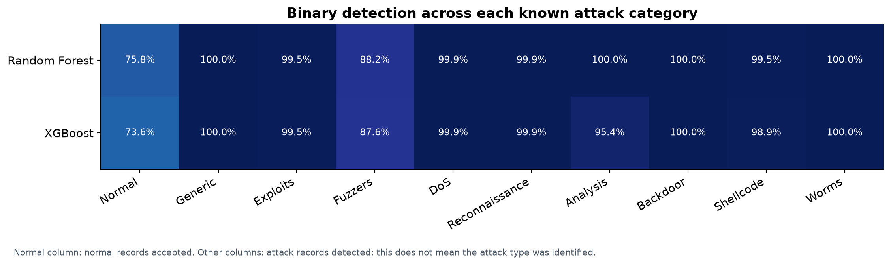
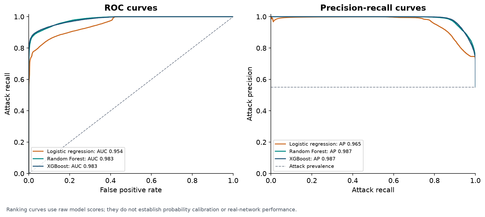
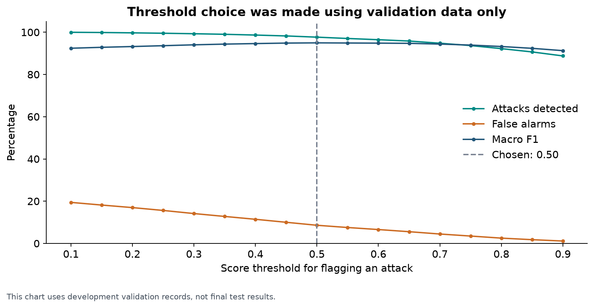
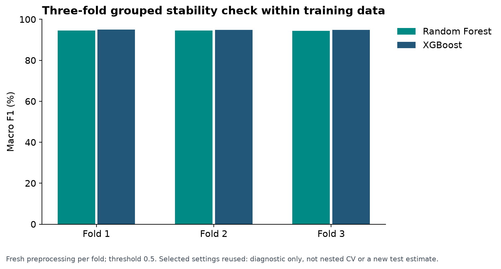
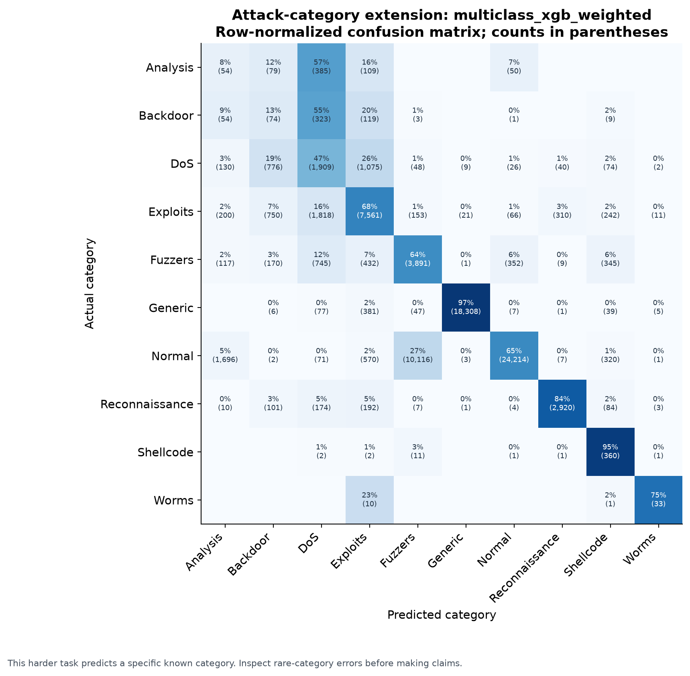
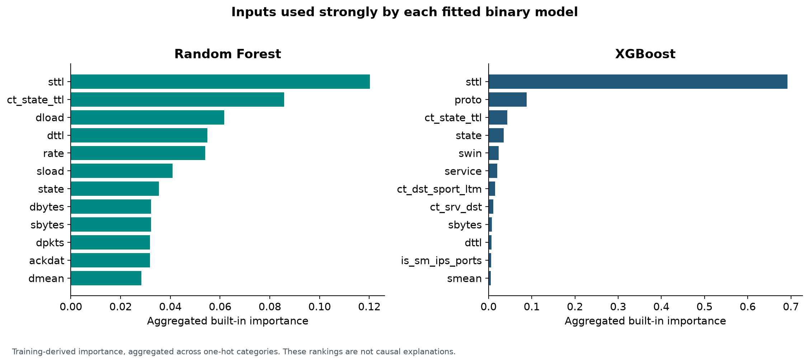

**Network Intrusion Detection with XGBoost and Random Forest**

Completed experiment report — 04 November 2026, 23:56 IST

This project trains software to classify recorded network flows as normal or attack. A separate extension predicts one of ten known categories. The deliverable includes fitted models, preprocessing, test predictions, source code, a walkthrough notebook and verified figures. The scope ends before building an app or connecting to live network traffic.

**What was built and the headline result**

The binary champion selected using grouped validation is **xgb_depth7**, with score threshold **0.50**. On the complete separate 82,332-row test partition it achieved **87.12% accuracy**, **98.12% attack recall**, **82.01% attack precision**, **86.53% macro F1** and **26.36% false positive rate**. These values are measured outputs, not targets or invented sample results.

It caught **44,480** attacks, missed **852**, correctly accepted **27,246** normal records and incorrectly flagged **9,754** normal records. The nonzero errors belong in the presentation. A benchmark score is not a claim of equal performance on a campus network.

**Dataset and provenance**

Canonical training data: the team's UNSW attachment, 175,341 rows. Canonical test data: a separate 82,332-row partition. Each contains 45 columns: a local ID, 42 predictors and two answers. ID, label and attack_cat are excluded from every model input. Original UNSW documentation and its dataset publications should be cited. The original SharePoint download redirected to sign-in; the complementary data was fetched from a public mirror pinned to commit `161024104f19eea98b5c9aba0499a8fcb867ba1d`.

The mirror filenames were reversed relative to the official row counts and the team's selected training data. Its 175,341-row file was exactly equal to the team's attachment after parsing, including row order. Canonical names were resolved by contents. Hashes and original URLs are in data/source_manifest.json; row counts and audits are in results/data_audit.json. Agreement with a public mirror does not establish author-signed provenance.

**Why the split matters**

Training contains 74,301 repeated feature rows beyond the first occurrence, and 229 feature groups have conflicting binary labels. A naive random row split can place identical examples in fitting and validation data. We grouped identical 42-feature records, then used a class-stratified approximately 80/20 development split. Fitting: 140,273 rows; validation: 35,068; exact-feature overlap: zero. Preprocessing is fitted on fitting rows only during selection. The full methodology and predefined grids are in METHODS.md and config/experiment.json.

**Preparation and model selection**

Numeric missing values use fitting-data medians; categorical missing values use fitting-data modes. proto, service and state are one-hot encoded; unknown categories are tolerated. Tree inputs remain unscaled, and the logistic baseline uses additional training-fitted scaling. No answer columns, local ID, oversampled test data or synthetic attacks enter the inputs. Existing frequencies and ambiguous labels are retained and documented.

Four binary XGBoost and three binary Random Forest candidates were compared with logistic and majority-prior baselines. Four tree candidates plus a majority baseline were tested for the categorical extension: 14 candidate fits in total. Selection used validation macro F1; thresholds came from a predefined validation-only grid. XGBoost stopped according to validation loss, then its selected tree count was reused for a complete-training refit. The selection record was frozen before final scoring. Selected settings are in results/selection_lock.json. No configuration or threshold was changed to improve final test results.

The binary champion had validation macro F1 94.96%, versus test macro F1 86.53%. This difference is part of the result and should not be hidden.

**Complete test comparison**

| Model | Accuracy | Attack precision | Attacks detected | Macro F1 | False alarms |
| --- | --- | --- | --- | --- | --- |
| Majority baseline | 55.06% | 55.06% | 100.00% | 35.51% | 100.00% |
| Logistic regression | 82.27% | 78.03% | 94.36% | 81.40% | 32.55% |
| Random Forest | 88.20% | 83.29% | 98.28% | 87.70% | 24.16% |
| XGBoost | 87.12% | 82.01% | 98.12% | 86.53% | 26.36% |

Attack precision means the proportion of flags that were actual attacks. Attack recall means the proportion of all attacks detected. False positive rate means the proportion of normal records wrongly flagged. Macro F1 averages class-level F1 equally, which makes both normal and attack performance matter. Selecting the champion used validation data; the table may show a different model looking stronger on an individual final test metric.

**Dataset overlap and additional views**

Exactly 8,541 test rows have a 42-feature match somewhere in training. Therefore a source-file boundary alone does not guarantee every test pattern is new. All test rows remain in the complete benchmark result. Additional fixed views make the limitation visible:

| View | Records | Accuracy | Attack recall | Macro F1 | False alarms |
| --- | --- | --- | --- | --- | --- |
| Entire test partition | 82,332 | 87.12% | 98.12% | 86.53% | 26.36% |
| No exact feature match in training | 73,791 | 86.35% | 97.80% | 86.03% | 25.99% |
| Unique unseen feature + answer | 52,648 | 82.59% | 96.06% | 82.28% | 25.00% |

The unique unseen view counts each feature-plus-binary-answer combination once. It changes weighting and should be reported separately, not substituted silently for the complete test result. Exact-feature separation still cannot guarantee separation by real connection, time or host; these reduced CSVs lack the identifiers needed to prove that stronger independence.

**Detection by attack category**

| Category | Test records | Correct binary decision | Errors |
| --- | --- | --- | --- |
| Analysis | 677 | 95.42% | 31 |
| Backdoor | 583 | 100.00% | 0 |
| DoS | 4,089 | 99.90% | 4 |
| Exploits | 11,132 | 99.47% | 59 |
| Fuzzers | 6,062 | 87.63% | 750 |
| Generic | 18,871 | 99.99% | 1 |
| Normal | 37,000 | 73.64% | 9,754 |
| Reconnaissance | 3,496 | 99.91% | 3 |
| Shellcode | 378 | 98.94% | 4 |
| Worms | 44 | 100.00% | 0 |

For Normal the percentage is normal acceptance. For every attack category it is binary attack recall. A binary model correctly flagging a DoS record has not necessarily identified that record as DoS.

**Score curves, thresholds and uncertainty**

ROC AUC and average precision describe score ranking across thresholds. Scores are uncalibrated model estimates; a displayed 0.9 score is not a validated 90% real-world attack probability. Default-threshold results are retained alongside the selected-threshold results in results/default_threshold_*.json.

The following intervals use 400 Poisson bootstrap replications grouped by exact test feature vector:

| Metric | Estimate | Descriptive 95% interval |
| --- | --- | --- |
| accuracy | 87.12% | 86.78%–87.45% |
| attack precision | 82.01% | 81.43%–82.59% |
| attack recall | 98.12% | 97.96%–98.27% |
| attack f1 | 89.35% | 88.99%–89.70% |
| macro f1 | 86.53% | 86.22%–86.82% |
| false positive rate | 26.36% | 25.87%–26.85% |

They describe uncertainty within this fixed benchmark with a fixed model. They exclude model-training uncertainty, tuning uncertainty, temporal drift and host/session correlation.

**Training-only stability check**

Both selected binary tree configurations were re-fitted using fresh preprocessing in each of three grouped folds inside the training partition. Settings were already selected from the same training partition, so this is a diagnostic, not nested cross-validation or an independent test score. It used threshold 0.5 throughout and did not change the winner. Detailed fold outcomes are in results/grouped_stability.csv.

**Attack-category extension**

| Model | Accuracy | Macro F1 | Weighted F1 |
| --- | --- | --- | --- |
| multiclass_dummy | 44.94% | 6.20% | 27.87% |
| multiclass_rf_balanced | 68.55% | 48.04% | 73.64% |
| multiclass_xgb_weighted | 72.05% | 52.54% | 76.02% |

The validation-selected categorical champion is **multiclass_xgb_weighted**: test accuracy **72.05%**, macro F1 **52.54%**. Accuracy and weighted F1 can mask poor rare-category identification; the full per-class precision/recall/F1 and confusion counts are included. This extension is an additional known-category classifier, not an open-set detector for previously unseen attack families.

**Model interpretation**

These built-in training importances are aggregated to original inputs. Correlated measurements and feature cardinality can affect their rankings. They help describe how the model uses the dataset; they do not establish causes or prove that a particular communication is malicious.

**What has been checked**

102 automated integrity/inference checks passed. They cover frozen experiment and model checksums, split separation, answer/ID exclusion, invariance to column order, missing-column rejection, invalid numeric inputs, unknown categorical values, missing-value handling, training-only preprocessing statistics, complete prediction coverage, independent reconciliation of confusion counts, native XGBoost export equivalence and fresh-process command-line prediction. The walkthrough notebook's execution is checked separately. See results/verification.json.

Candidate warnings recorded during selection: 0. No warnings were captured from candidate model fitting.

**Scope, limitations and next steps**

This is a working offline benchmark project with reusable model files. It does not inspect live Wi-Fi, capture packets, block attacks or establish deployment readiness. Dataset collection, duplicate patterns and train/test distribution differences limit real-network generalization. Conflicting identical-feature labels constrain what a deterministic classifier can reproduce from these measurements. Rare classes require particular caution. Final thresholds reflect a benchmark macro-F1 objective rather than an operational security cost budget.

The next product step is an interface that loads the saved binary bundle and applies the exact stored preprocessing to schema-compatible records. For the upcoming presentation, demonstrate answer-free sample prediction, explain the training/test separation and show real error counts. Obtain the guide's approval for the project scope and poster; no faculty approval is implied by this technical run.

**Sources and citations**

Dataset description and original publications: [UNSW-NB15](https://research.unsw.edu.au/projects/unsw-nb15-dataset). In the project bibliography include Moustafa & Slay (2015), *UNSW-NB15: A comprehensive data set for network intrusion detection systems*, and the additional dataset citations requested on the source page.

Algorithms: Chen & Guestrin (2016), [XGBoost: A Scalable Tree Boosting System](https://arxiv.org/abs/1603.02754); Breiman (2001), [Random Forests](https://www.stat.berkeley.edu/~breiman/randomforest2001.pdf).

Method guidance: [Scikit-learn leakage prevention](https://scikit-learn.org/stable/common_pitfalls.html), [grouped stratification](https://scikit-learn.org/stable/modules/generated/sklearn.model_selection.StratifiedGroupKFold.html), [threshold selection](https://scikit-learn.org/stable/modules/classification_threshold.html), [evaluation metrics](https://scikit-learn.org/stable/modules/model_evaluation.html), and [XGBoost early stopping](https://xgboost.readthedocs.io/en/stable/python/sklearn_estimator.html).

Data retrieval mirror: [https://github.com/jamshaid120/UNSW_NB15-Complete-dataset](https://github.com/jamshaid120/UNSW_NB15-Complete-dataset); the full pinned download URLs and checksums accompany the data. The mirror supplies files; the measured results in this report come from this local experiment.
